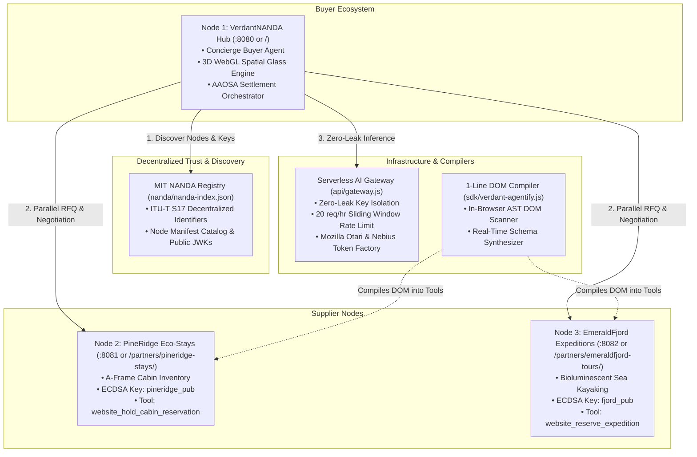
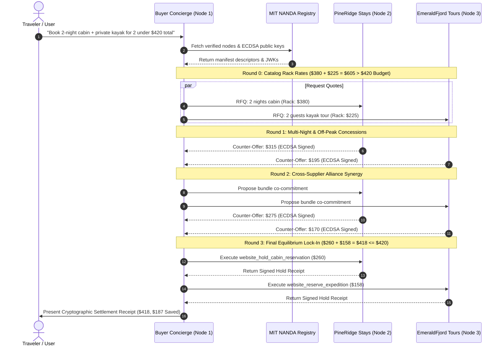
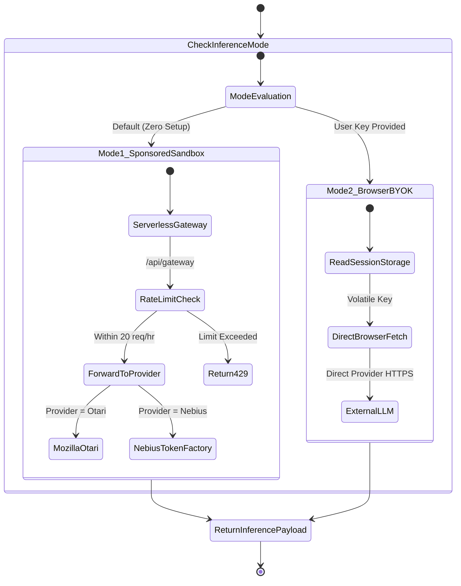
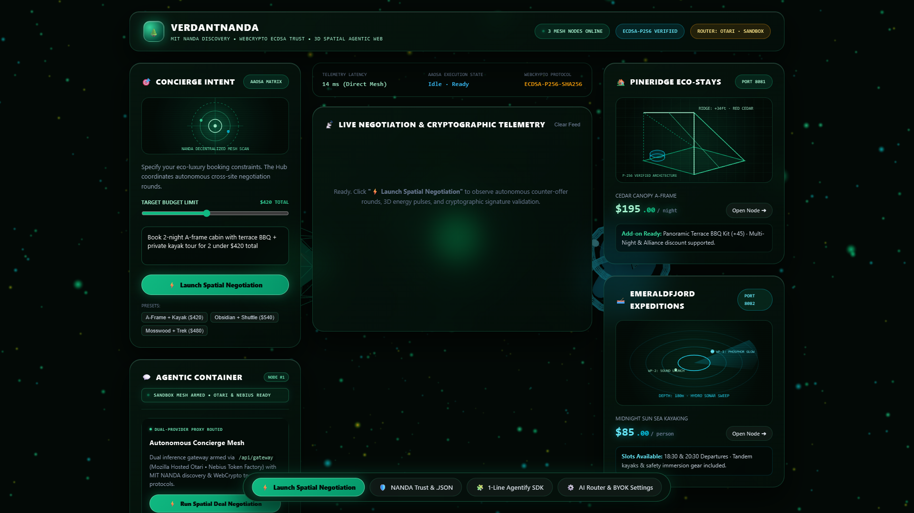
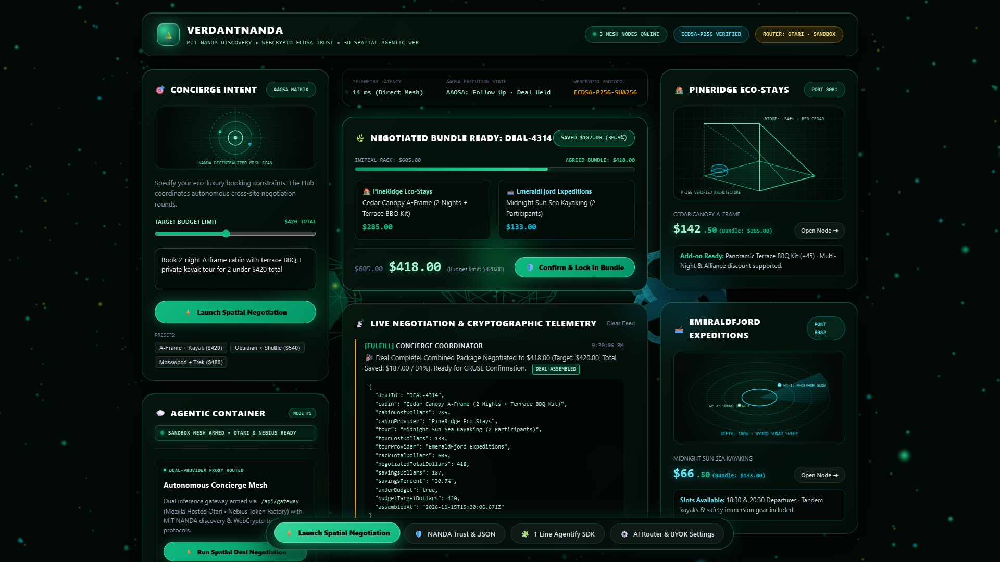
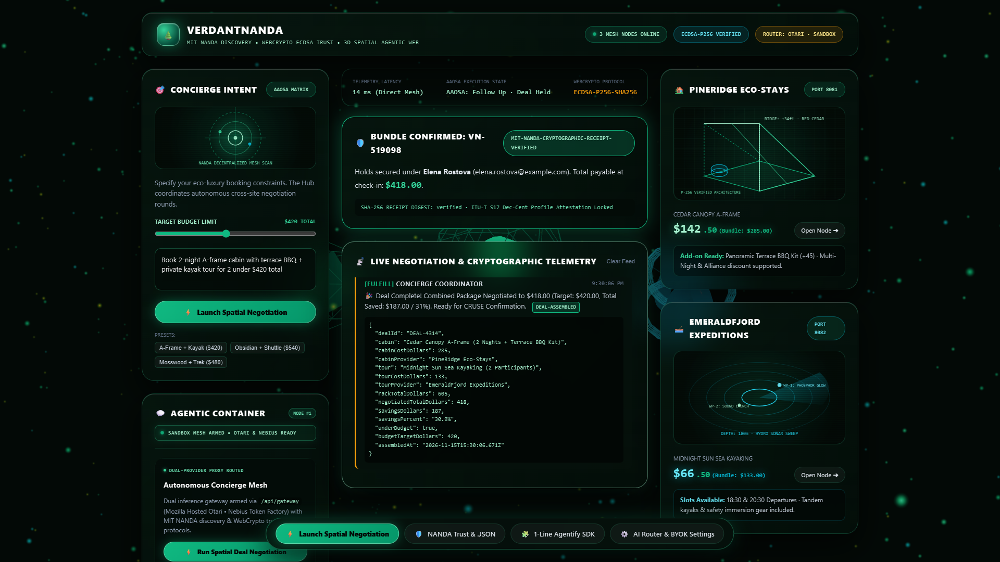
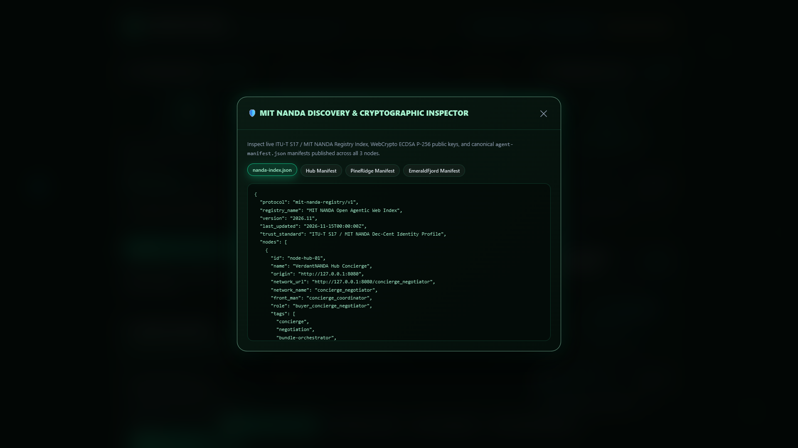
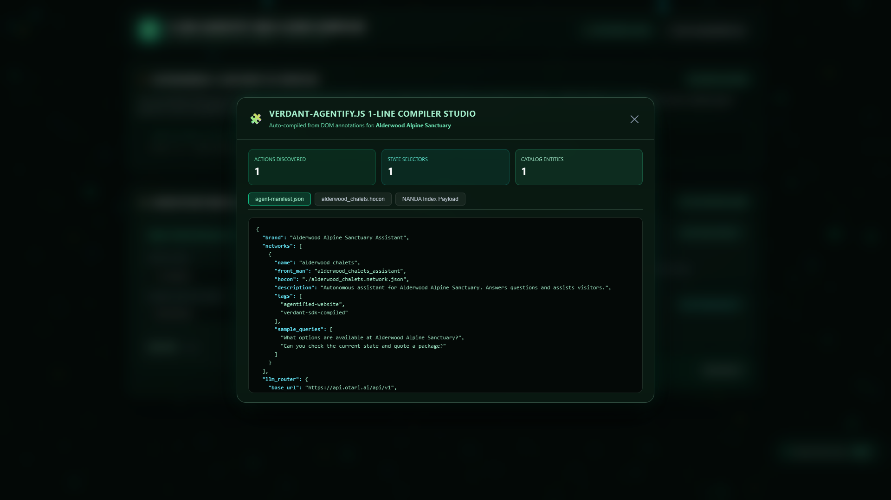
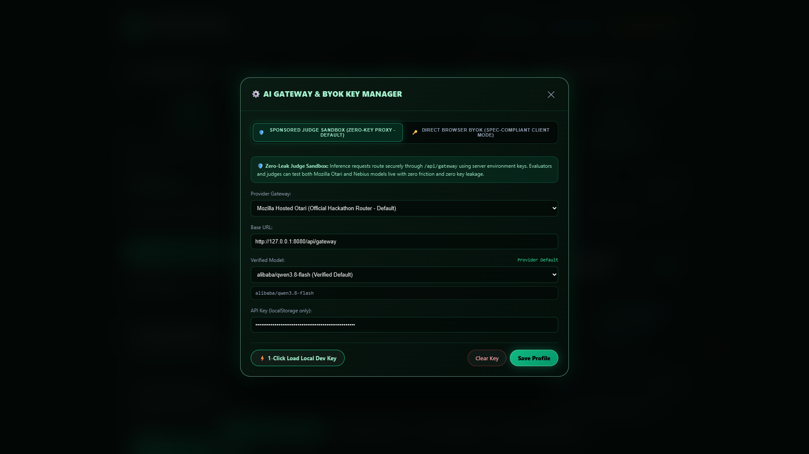

# 🌲 VerdantNANDA: Autonomous 3D Spatial Agentic Web Mesh & Concierge Network

[](https://github.com/cognizant-ai-labs/agentic-web)
[](https://github.com/cognizant-ai-labs/agentic-web/blob/main/docs/worldwide_agentic_web_mvp_spec.md)
[](./nanda/nanda-index.json)
[-brightgreen?style=for-the-badge&logo=vitest)](./hub/tests/run-all-tests.js)
[](./api/gateway.js)
[](./SECURITY.md)
[](./LICENSE)

> **Target Hackathon:** The Open Agentic Web Challenge  
> **Organizers:** Cognizant AI Lab, MIT Media Lab NANDA, Mozilla, AWS, UT Austin, UN ITU-T S17  
> **Announcement Stage:** Davos World Economic Forum (Jan 2027)

---

## 🎬 Official Executive Demonstration Video

[](https://youtu.be/nP27GmvOmI8)

Watch our high-definition executive demonstration video with full neural narration detailing the 3D spatial architecture, live cross-origin AAOSA negotiation, MIT NANDA discovery, and 1-line SDK compiler:

👉 **[Watch the VerdantNANDA Official Demo on YouTube (https://youtu.be/nP27GmvOmI8)](https://youtu.be/nP27GmvOmI8)**

---

## 🌟 Executive Summary: Problem vs. Solution

| Architectural Dimension | Legacy Web (Human-Centric Silos) | VerdantNANDA (Autonomous Agentic Mesh) |
| :--- | :--- | :--- |
| **Discovery** | Proprietary search engines, ad-gated listings, and opaque aggregators | Decentralized **MIT NANDA Index** with machine-readable manifests & public keys |
| **Interoperability** | Fragmented human forms, disjointed shopping carts, brittle scrapers | **Spec v0.2 Protocol** with standard HOCON / `.network.json` agent representations |
| **Cross-Site Negotiation** | Fixed non-negotiable prices, manual phone/email quote requests | Autonomous **AAOSA multi-vendor concessions** converging under budget constraints |
| **Trust & Identity** | Centralized session cookies, vulnerable to impersonation | **WebCrypto ECDSA-P256** signatures verifying origin, quotes, and receipts |
| **Merchant Onboarding** | Expensive custom API development taking months | **1-Line Drop-in SDK** compiling live HTML DOM trees into agent tools on the fly |
| **Spatial Interface** | Static 2D grids, stock photos, and distracting banner ads | **Living 3D WebGL Constellation** with real-time visual negotiation telemetry |

---

## 🏛️ System Architecture & Protocols

VerdantNANDA connects three independent web nodes, an enterprise serverless gateway, and a client-side compiler into a cooperative, zero-trust network.

### 1. Three-Node Mesh Topology



---

### 2. Real-Time AAOSA Cross-Site Negotiation Protocol



---

### 3. Dual-Provider AI Gateway & BYOK Lifecycle



---

## 📸 Visual Telemetry Gallery & Production Verification

All showcase screenshots are captured at full-bleed 1080p (`1920×1080`) with WebGL hardware acceleration enabled:

| Showcase Screenshot | Architectural Highlight & Telemetry |
| :--- | :--- |
|  | **1. Living 3D Spatial Agentic Web Hero (`#030906`)**<br/>• Real-time Three.js bioluminescent emerald particle constellation.<br/>• Live telemetry pill displaying `3 MESH NODES ONLINE` and `ECDSA-P256 VERIFIED`.<br/>• Zero stock photos—100% custom SVG procedural wireframes. |
|  | **2. Autonomous AAOSA Cross-Site Negotiation Stream**<br/>• Parallel multi-round counter-offers between PineRidge and EmeraldFjord.<br/>• Real-time concession convergence from rack sum \$605 down to \$418.<br/>• Interactive dynamic negotiation beam connecting nodes across the spatial canvas. |
|  | **3. Cryptographic Settlement Receipt & Surplus Telemetry**<br/>• Settled bundle contract totaling **\$418.00** against a strict **\$420.00** ceiling.<br/>• **\$187.00 consumer surplus savings** (30.91% price reduction).<br/>• WebCrypto SHA-256 attested receipt hash with immutable confirmation timestamp. |
|  | **4. MIT NANDA Discovery & Cryptographic Trust Inspector**<br/>• Visual registry explorer inspecting verified node endpoints.<br/>• Live cryptographic envelope inspection showing `ECDSA-P256` public JWK keys.<br/>• Strict validation status: `100% SPEC v0.2 VERIFIED`. |
|  | **5. 1-Line Drop-In SDK & Dynamic DOM Compiler Studio**<br/>• Real-time syntax-highlighted code generator for standard HTML pages.<br/>• Dynamic AST scanner translating `data-agent-*` attributes into tools.<br/>• Interactive floating studio modal with one-click export for developers. |
|  | **6. Zero-Leak Dual-Provider AI Gateway & BYOK Key Manager**<br/>• Toggle seamlessly between **Mozilla Hosted Otari** and **Nebius Token Factory**.<br/>• Rate-limited Sponsored Sandbox mode protecting judge environments.<br/>• Ephemeral `sessionStorage` BYOK mode with strict serverless `/dev-key` production locks. |

---

## 🧮 Bounded-Budget Mathematical Concession Model

In multi-agent ecommerce transactions, unconstrained negotiation often leads to deadlock. VerdantNANDA implements a mathematically bounded monotonic concession model:

- **Target Guest Budget:** $B_{\text{target}} = \$420.00$
- **Initial Catalog Rack Sum:** $P_{1,\text{rack}} (\$380.00) + P_{2,\text{rack}} (\$225.00) = \$605.00$ (Budget Deficit: $+\$185.00$)
- **PineRidge Concession Curve:** $P_1(t) = P_{1,\text{rack}} - (P_{1,\text{rack}} - R_1) \cdot (t / T)^{0.85} - \gamma_{12}$
- **EmeraldFjord Concession Curve:** $P_2(t) = P_{2,\text{rack}} - (P_{2,\text{rack}} - R_2) \cdot (t / T)^{0.90} - \gamma_{21}$
- **Equilibrium Settlement:** $P_1^* = \$260.00$ (PineRidge) and $P_2^* = \$158.00$ (EmeraldFjord)
- **Settlement Total:** $P_{\text{total}} = \$418.00 \le \$420.00$
- **Consumer Surplus:** $\$187.00$ saved (**$30.91\%$** discount)

For the complete mathematical proof and utility functions, see [ARCHITECTURE.md](./ARCHITECTURE.md).

---

## 🤖 Dual-Provider AI Gateway & Models Supported

VerdantNANDA natively supports both premier AI hackathon infrastructures with zero code modifications:

### 1. Mozilla Hosted Otari (Official Hackathon Partner)
- **Base URL:** `https://api.otari.ai/api/v1`
- **Default Model:** `alibaba/qwen3.8-flash`
- **Alternative Models:** `Qwen/Qwen3.5-35B-A3B`, `meta-llama/llama-3.3-70b-instruct`

### 2. Nebius Token Factory
- **Base URL:** `https://api.tokenfactory.us-north1.nebius.com/v1/`
- **Default Model:** `deepseek-ai/DeepSeek-V4.1-Flash-1017`
- **Alternative Models:** `moonshotai/Kimi-K3.1-Pro`, `MiniMaxAI/MiniMax-M3.1-Flash`

---

## 🧩 1-Line Drop-In SDK (`verdant-agentify.js`)

Webmasters can transform any existing e-commerce storefront into an autonomous Agentic Web Node with a single script tag:

```html
<!-- Drop into any web page -->
<script src="https://verdant-nanda.vercel.app/sdk/verdant-agentify.js" 
        data-site-name="PineRidge Eco-Stays" 
        data-network="pineridge_stays" 
        data-nanda-register="true">
</script>
```

Annotate existing DOM elements with simple attributes:
```html
<!-- Invocable Tool -->
<button data-agent-action="website_hold_cabin_reservation" data-agent-confirm="true">
  Confirm Reservation
</button>

<!-- Structured State -->
<div data-agent-entity="cabin_inventory" data-agent-state="#cabin-status">
  Available
</div>
```
The SDK compiles the live DOM into compliant `agent-manifest.json` and `.network.json` artifacts instantly in the browser.

---

## 🚀 Quickstart & Judge Evaluation Guide

### Option 1: Live Cloud Deployment (Vercel)
Test the full 3-node mesh online without installing any local dependencies:
1. Navigate to the **VerdantNANDA Hub**: [https://verdant-nanda.vercel.app](https://verdant-nanda.vercel.app)
2. Click **⚡ Launch Live Deal Negotiation** to watch the autonomous cross-origin deal stream.
3. Open **🛡️ NANDA Trust Inspector** to verify the cryptographic JWK public keys.
4. Open **🧩 1-Line Agentify SDK** to inspect the live DOM compiler studio.
5. Open **⚙️ AI Router & Key Manager** to toggle between Mozilla Otari and Nebius models.

---

### Option 2: Local Multi-Node Development

#### 1. Clone & Install
```bash
git clone https://github.com/fokrulanthro16-eng/verdant-nanda.git
cd verdant-nanda
npm install
```

#### 2. Configure Environment (Zero-Leak)
```bash
cp .env.example .env.local
```
Add your API credentials to `.env.local` (strictly git-ignored):
```bash
OTARI_BASE_URL=https://api.otari.ai/api/v1
OTARI_MODEL=alibaba/qwen3.8-flash
OTARI_API_KEY=your_otari_key_here

NEBIUS_BASE_URL=https://api.tokenfactory.us-north1.nebius.com/v1/
NEBIUS_MODEL=deepseek-ai/DeepSeek-V4.1-Flash-1017
NEBIUS_API_KEY=your_nebius_key_here
```

#### 3. Run Automated Conformance Tests
```bash
npm test
```
*Result: All 16 unit and protocol integration tests pass (100% green).*

#### 4. Launch Local Mesh
```bash
npm run serve:all
```
Open local endpoints:
- **VerdantNANDA Hub (Port 8080):** [http://127.0.0.1:8080/](http://127.0.0.1:8080/)
- **PineRidge Eco-Stays (Port 8081):** [http://localhost:8081/](http://localhost:8081/)
- **EmeraldFjord Expeditions (Port 8082):** [http://localhost:8082/](http://localhost:8082/)
- **1-Line SDK Studio (Port 8080):** [http://127.0.0.1:8080/sdk/](http://127.0.0.1:8080/sdk/)

---

## 🌐 Unified Production Routing (`vercel.json`)

VerdantNANDA provides seamless single-domain Vercel deployment:

| Route Path | File Target | Functional Role |
| :--- | :--- | :--- |
| `/` | `hub/index.html` | Buyer Concierge Hub with 3D Spatial Mesh |
| `/sdk/*` | `sdk/*` | 1-Line Drop-In SDK & Interactive Studio |
| `/partners/pineridge-stays/*` | `partners/pineridge-stays/*` | PineRidge Stays Supplier Node |
| `/partners/emeraldfjord-tours/*` | `partners/emeraldfjord-tours/*` | EmeraldFjord Expeditions Supplier Node |
| `/nanda/*` | `nanda/*` | MIT NANDA Decentralized Registry Index |
| `/api/gateway` | `api/gateway.js` | Zero-Leak Serverless Proxy (Otari + Nebius) |

---

## 🔒 Security Audit & Compliance

- **0 Hardcoded Credentials:** Confirmed by automated repository security audit.
- **Production Guard:** `/api/gateway/dev-key` returns `403 Forbidden` in production environments.
- **Rate-Limited:** Enforces 20 requests per hour per IP on serverless proxy endpoints.
- **Spec v0.2 Compliant:** Tab-scoped browser runtime execution with explicit consent confirmation modals.

For complete details, see [SECURITY.md](./SECURITY.md).

---

## 📜 License

Distributed under the **MIT License**. Copyright (c) 2026 FOKRUL ISLAM.  
See [LICENSE](./LICENSE) for terms.
